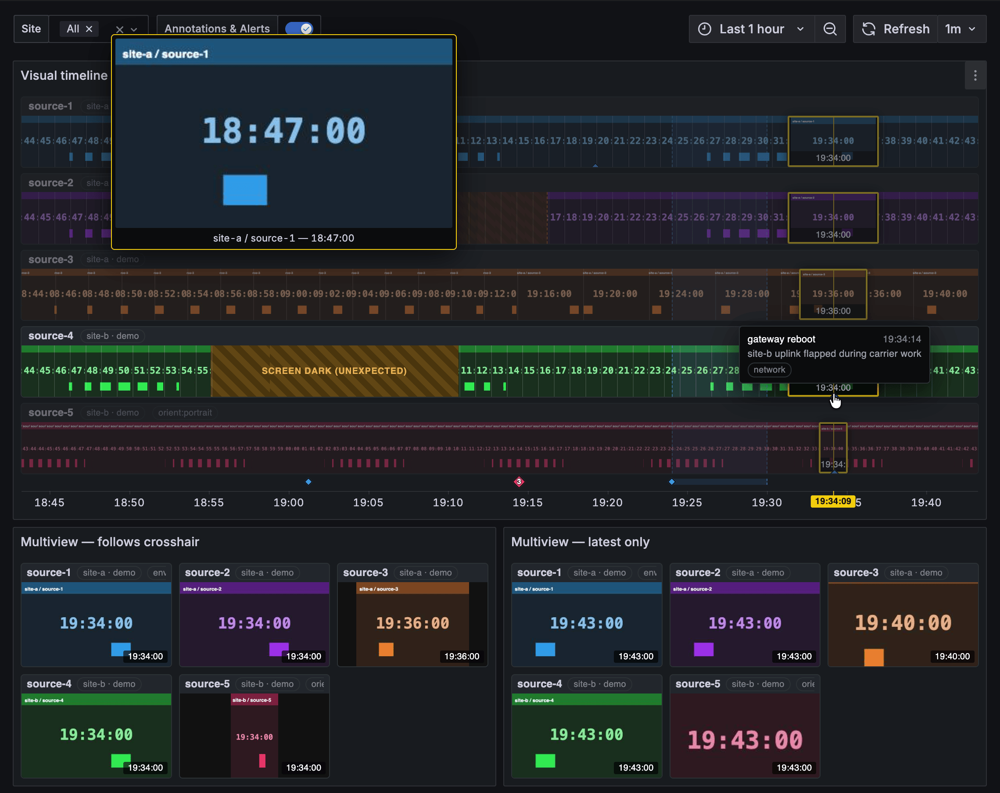

# Visual Timeline

[](https://github.com/comebacktomorrow/visual-timeline/actions/workflows/ci.yml)
[](https://github.com/comebacktomorrow/visual-timeline/blob/main/CHANGELOG.md)
[](https://github.com/comebacktomorrow/visual-timeline/blob/main/LICENSE)

> **`main` is Visual Timeline 2.0, in development.** It reads frames from any
> data source and drops 1.x's frames API mode
> ([#126](https://github.com/comebacktomorrow/visual-timeline/issues/126)).
> The current release is 1.2.3: see its
> [README](https://github.com/comebacktomorrow/visual-timeline/blob/v1.2.3/README.md).

Scrubbable visual timeline and multiview for image feeds — kiosk screens,
security cameras, website thumbnails, anything that can post a JPEG on a
heartbeat. Hover to set a global time cursor across every host; gaps show
offline periods at their true temporal width; drag to zoom.

The plugin is a Grafana app that installs two plugins:

- the **Visual Timeline panel**, which draws the timeline and the multiview
  grid;
- the **Visual Timeline data source**, which reads timestamped images from a
  web folder or a public bucket (the **HTTP folder** connection:
  [docs/FOLDERS.md](https://github.com/comebacktomorrow/visual-timeline/blob/main/docs/FOLDERS.md)),
  or runs everything on built-in **Demo data**. It supplies the Site and Host dashboard
  variables, the ad hoc filter bar and annotations, and can answer with each
  host's last frame and status, for a stock Table, Canvas or Stat panel.

The panel reads your own frames from
[any data source](#frames-from-any-data-source) whose rows have a time, an
image and a host.

The app is enabled on install and has no pages of its own.



## What it shows

Each host is a strip of its frames over time, each frame shown until the
next. A host that declares its _cadence_ (a cadence field, its source's
declared pace, or the panel's **Expected cadence**) promises a frame on that
heartbeat, so the _absence_ of a frame carries meaning: a broken promise is
drawn as offline. A host that declares nothing promises nothing, and its
silences are neutral "no data", never offline.

- **Offline gaps at their true width.** A promised frame that doesn't come is
  drawn as a hatched gap on the timeline, as wide as the outage really was
  (even when it's shorter than a slot), and as an offline tile in the
  multiview. Hosts drop failed frames rather than queueing them:
  the gap **is** the signal.
- **Changes of pace.** Each frame's promise is its own: when a host changes
  its cadence (slowing down for quiet hours, say), its frames promise the new
  pace, so a slow stretch isn't a wall of false gaps.
- **Pauses.** A host that goes quiet on purpose (from a state query whose
  field is set to **Pauses frames**) shows the pause as a band, labelled and
  coloured by its value mappings, instead of as missing frames. A host that
  stops without anything saying so still renders as offline.
- **States.** Other states from a state query, ones that don't stop the
  frames, are drawn on the host's strip like region annotations.
- **The pending slot.** When a frame's expected time has passed but it hasn't
  arrived yet, the slot shows the last known frame as a pulsing ghost rather
  than a fault. A missed heartbeat still turns red on schedule.

Two display modes:

- **Timeline** — one strip per host along a shared time axis. Hover to scrub;
  drag to zoom, which sets the dashboard's time range.
- **Multiview grid** — one tile per host, showing the frame at the shared
  crosshair time (or just the latest frame in range).

The crosshair is shared both ways with the other panels on the dashboard:
hover a graph and the timeline and grid follow, hover the timeline and the
graphs follow.

The panel also draws the dashboard's own annotations on the timeline, from any
annotation query on any data source. Point annotations are diamond markers and
regions shade their span. An annotation tagged `host:<id>` pins to that
host's strip; the rest share a lane above the axis.

The panel follows Grafana's light and dark themes, including a live switch,
and scrubbing stays smooth with many hosts.

### How a time range is drawn

A frame is shown from its own time until the next frame replaces it. What
happens when the next one is late depends on whether the host **promised** a
cadence ([docs/TIMELINE-MODEL.md](https://github.com/comebacktomorrow/visual-timeline/blob/main/docs/TIMELINE-MODEL.md)):

- **A host that promises a cadence** (a `cadence` field on its rows, a host
  table's, the panel's **Expected cadence**, the folder's **Expected every**,
  or the reference worker's declared pace) promises its next frame within
  it. A frame more than half a cadence late breaks the promise, and the
  time from when it was due until the next frame is **dropped**: red, as
  offline. That is the only red.
- **A host that promises nothing** is never red. Its frame is shown until
  the next one, up to **Hold frames without a promise** (Auto: three times
  the typical gap around it); past that, a neutral "no data". A camera that
  sends frames at uneven times draws as one continuous strip.

The timeline doesn't fetch every frame in the range. Each host gets about
one slot per **Frame width** of panel width (7 px by default, about 190
slots on a full-width panel):

- **The step is a whole number of the host's cadence.** A host that uploads
  every minute shows one frame per minute at short ranges, and one in every
  N minutes at longer ones: 2 minutes over 6 hours, about 54 minutes over 7
  days. Turn on **Show cadence details** to see it, for example `⏱ 1m ·
1/2m ↓` (`~10m · no promise` for a host that promises nothing).
- **A slot shows a frame taken within it,** the one nearest its tick, or
  else the frame in force. Slots showing the same frame side by side are one
  cell: a frame that stood for 20 minutes is 20 minutes wide. Dropped time
  shorter than a slot is marked at its true place, so zooming out doesn't
  hide a short outage.
- **A slot shows a slice.** Each slot shows a vertical slice from the middle
  of its frame. Hover for the whole frame in the magnifier; click for the
  preview player (below).
- **The frames a slot can't show.** A slot zoomed out over many frames shows
  one. Its magnifier says how many it holds ("· 4 frames"); rest the cursor
  on it for three seconds and the magnifier plays them. Click it for the
  preview player.
- **Images load newest first.** Across all the hosts in a panel, the
  thumbnails load from the live edge backwards, a few at a time, so on a
  slow connection the most recent frames appear first. Browsers keep the
  frames cached, so a dashboard refresh doesn't download them again.
- **The live edge follows the dashboard's refresh.** New frames arrive with
  each refresh; between refreshes the panel slides the strip along on its
  own: a promised frame that comes due is "expected" for one more cadence,
  then dropped. A short auto-refresh keeps
  it near live. It doesn't use Grafana Live streaming.
- **The time axis matches Grafana's own time series panel:** the same tick
  spacing, steps and label formats.

### The preview player

Clicking a frame opens it large, with the slot's own timeline underneath:
the frames the slot holds, at their true times, as ticks or as small
pictures, over the same red (offline), neutral (no data) and pause
stretches the strip draws.

- **Within the slot** (the dashboard's crosshair stays still): hover or drag
  the timeline; ‹ › step frame by frame (← →); ▶ plays the slot's frames
  round and round, stopping on a gap long enough to show its reason.
- **To the next slot:** ‹‹ ›› (Shift+← →), and the dashboard's crosshair
  follows.
- **Zoom** (the magnifying glass) sets the dashboard's time range to the
  slot. A slot holding more frames than its timeline can tell apart (a
  tick per Frame width) shows as many as fit, says so in the title
  ("showing 57 of 456"), and highlights Zoom.
- The large image loads once the playhead settles; Esc or ✕ closes.
- **Video** (below): where a clip covers the slot, it plays over the
  frames. Its part of the timeline is a plain bar to hover or drag through,
  ▶ plays it (round again at the slot's end), and the bar gains sound
  (muted by default) and HD/SD (when the clip has a larger version), both
  remembered. The speed button becomes the video's speed: it starts at
  whatever plays the slot's video in about ten seconds (1× for a short
  clip, faster for more), and a click steps up through 1×, 2×, 4×, 8×
  and 16×.
- **Zoomed out**, a slot can hold more video than plays in ten seconds at
  16×. It's then played as a slot of many frames is: its frames, as many
  as fit, with the video as a bar under them, and Zoom highlighted to watch
  it.

The player asks for one slot's frames when it needs them, by running the
panel's own query again for just that slot, no finer than it can draw.
Any data source that filters by the dashboard's time range (SQL with
`$__timeFilter`, Loki, Infinity with `${__from}`, the HTTP folder) answers
it.

Times follow the dashboard's time zone. A host can also say where it is,
with the `X-Timezone` upload header (an IANA name such as
`Australia/Sydney`). Its header then shows its city and how far its clock is
from the dashboard's, for example `Sydney · +3h`, and the **Thumbnail times**
option can show its frame times in its own local time.

## Try it with no backend

1. Add a **Visual Timeline** data source (**Connections → Data sources →
   Add new data source**), choose **Demo data** as its **Connection** and
   click **Save & test**.
2. On the data source's **Dashboards** tab, import the **Visual Timeline**
   dashboard: a timeline, two multiview grids and a table of each host's
   last frame, with Site and Host dropdowns and a filter bar.

The demo has five simulated hosts across two sites, including an outage, a
cadence change, a declared pause, two hosts in other time zones and some
annotations. No infrastructure and no account. To build your own dashboard
instead, add a **Visual Timeline** panel and choose the data source in its
**Query** tab. For your own frames, see
[Frames from any data source](#frames-from-any-data-source).

To see it on a ready-made dashboard instead, clone the
[repository](https://github.com/comebacktomorrow/visual-timeline) and run:

```bash
docker compose -f demo/docker-compose.yml up
# → http://localhost:3300/d/visual-timeline-demo  (anonymous admin)
```

The first run builds the plugin, so it takes a few minutes. The dashboard has
a timeline, two multiview grids and a time series panel to show the shared
crosshair, all on the built-in demo data. Port 3300 taken? Prefix the command
with `DEMO_PORT=3301`.

Three more dashboards there read real, public feeds (they need internet access):

- **Rivers** (`/d/vt-rivers`): four USGS river cameras, each a day's light
  and night gap in its own time zone, beside the rivers' gauge heights. The
  frames come straight from the USGS's public bucket through the
  [HTTP folder](docs/FOLDERS.md) connection; the camera details and water
  levels come from USGS APIs through Infinity.
- **The Sun** (`/d/vt-sun`): NASA SDO's images of the Sun in four channels,
  read from its web folder, above GOES X-ray flux, with solar flares as
  annotations across both.
- **Volcanoes** (`/d/vt-volcanoes`): six USGS volcano cameras (Kīlauea, Mauna
  Loa, Mount St. Helens, Spurr, Yellowstone), each at its own pace from every
  2 minutes to hourly, read from USGS's AshCam API through Infinity, with
  night from the same API as a state.

They are examples of the panel on data it knows nothing about: a folder, a
bucket and three JSON APIs, none of them made for it.

## Filter by site, host and tag

Every host has an id, a site and optional `key=value` tags, and
panels can be filtered by any of them, the way Grafana filters Prometheus or
Loki data by label:

- **In a panel's Query tab:** **Sites**, **Hosts** and **Tags** fields. Each
  takes ids (`home, office`) or dashboard variables (`${site:csv}`); empty
  means all.
- **With dashboard variables:** add a **Query** variable on a Visual Timeline
  data source and choose **Sites** or **Hosts**. A Hosts variable can list
  only the hosts in some sites, for example `${site:csv}`, so Host follows
  Site. Use the variables in the panels' Query fields.
- **With the filter bar:** add an **Ad hoc filters** variable on the data
  source. Its keys are `site`, `host` and every tag key, each with a list of
  values, and the operators are `=`, `!=`, `=~` and `!~` (regular expressions
  match the whole value). Grafana also offers `<` and `>`, which this data
  source ignores.
- **By clicking:** click a host, site or tag in a host's header to add it to
  the dashboard's filter bar.

The **Visual Timeline** dashboard on the data source's Dashboards tab has the
Site and Host variables and the filter bar ready.

## Frames from any data source

The panel draws frames from any query that returns, per row, **a time, an
image and a host**: a SQL table of snapshot records, Infinity reading an API,
TestData, or the Visual Timeline data source's Demo data. The image is a URL that the
viewer's browser can load (public, or signed by whatever answered the query)
or Base64 image data. The panel never signs or proxies images itself.

| Field         | Usual names                                                        |                                                                                                                              |
| ------------- | ------------------------------------------------------------------ | ---------------------------------------------------------------------------------------------------------------------------- |
| Time          | the first time field, or `time`, `timestamp`                       | required                                                                                                                     |
| Image         | `image`, `url`                                                     | required                                                                                                                     |
| Host          | `host`, `source`, `camera`; or a `host` label; or the query's name | required                                                                                                                     |
| Site          | `site`, or a `site` label                                          | optional                                                                                                                     |
| Preview image | `image_hi`, `preview`                                              | optional, for the click-in preview                                                                                           |
| Cadence       | `cadence` (milliseconds)                                           | optional; otherwise the typical gap between frames. A value that changes over time draws each pace on its own grid (an era). |
| Host details  | `timezone`, `location`, `tags`; or labels on the image field       | optional, shown in the host's header                                                                                         |
| Video         | `video`, with `video_hi`, `video_end` or `video_duration` (ms)     | optional: a clip from the row's time, played in the preview (below)                                                          |

A **wide table** works too, as a SQL pivot returns it: one time column and an
image column per host, each column named for its host (or carrying a `host`
label).

**Tested** on every pull request, against the dev stack: PostgreSQL (and so
SQL generally), Loki, TestData and the Visual Timeline data source; Infinity
is checked by hand. InfluxDB and Elasticsearch should work but aren't tested.
Recipes for each are in
[docs/DATA-SOURCES.md](https://github.com/comebacktomorrow/visual-timeline/blob/main/docs/DATA-SOURCES.md).

When your fields have other names, set them under **Frame fields** in the
panel options. Two more kinds of query can join the frames in a panel: **host
state** (rows of time, host and a `state` field, labelled and coloured by its
value mappings; set **Pauses frames** on the field for states during which a
host sends nothing), and a **host table** (rows of host and its details, with
no image or state, so hosts that sent no frames still show). The details are in
[docs/INFINITY.md](https://github.com/comebacktomorrow/visual-timeline/blob/main/docs/INFINITY.md),
whose recipes work for any data source. The provisioned dashboard **Visual Timeline — any data
source** shows a timeline and a grid drawn from TestData CSV rows.

### Video clips

A row can carry a **video** as well as its image: a clip that starts at the
row's time and runs to its `video_end` (a time), or for `video_duration`
milliseconds; with neither, as long as the host's clips typically last,
never past the next one. `video_hi` is a larger version for the preview
player. A clip of real time and a timelapse (a whole day in seconds) work
alike: a time within the clip is found by its fraction of the way through
it.

**Keep the frames coming alongside the video.** They fill the strip and the
player's thumbnails, and they're what a zoomed-out slot shows. A host with
only clips works (they draw as plain bands with ▶, and a zoomed-out slot
shows frames taken from the video itself, which is slower), but isn't the
way to set one up.

- **The strip doesn't change**: frames still fill it. **Mark video on the
  strip** (a panel option, off by default) draws a thin line along its foot
  where the host has video.
- **The preview player plays the clip over the frames** (above). The hover
  flipbook plays the smaller version in the magnifier, muted.
- **Formats:** whatever the viewer's browser plays: MP4 (H.264) or WebM
  (VP9) are safe. Serve them with range requests, and for MP4 put the index
  at the front (`ffmpeg -movflags +faststart`): a file with it at the end
  can't seek until the browser has fetched its tail.
- A clip that began before the dashboard's range is only found if the query
  returns it: include the clip in force at the range's start, as you would
  the frame before it.

## Show the last frame in a table

Turn on **Last frame** in a query and the data source also answers with each
host's last frame in the dashboard's time range, for a stock **Table** panel
(or, in the **Per host** format below, a Canvas or Stat panel):

| Column           | What it holds                                                                                          |
| ---------------- | ------------------------------------------------------------------------------------------------------ |
| **Last frame**   | The frame's image, set to show as one in a Table. Give the table a taller **Cell height** to see more. |
| **Status**       | `live`, `offline`, `paused` or `nodata`: the host's state at the end of the time range.                |
| **Frame time**   | When the frame was taken.                                                                              |
| **Pause reason** | Why a paused host said it was pausing (`screen-sleep`, `quiet`, …).                                    |

It is the last frame _in the time range_, as a Stat panel's "Last" is the
last value: while the range ends now, it's the live frame, and auto-refresh
keeps it current; for a past range, or after zooming in on a timeline, it's
each host's frame at the end of that range. A host offline at that moment
shows the last frame it took before, and one with no frame in the range has
an empty cell. Status follows the timeline's rules: offline once a promised
frame is a full cadence overdue, paused from a declared pause until a frame a
tick or more into it. A host that promises no cadence is never offline: it's
`nodata` once its last frame is older than three typical gaps.

Leave it off in the queries of Visual Timeline panels, which draw every
frame anyway. The starter dashboard has a **Last frame per host** table.

### On a Canvas: frames on a floor plan

A **Canvas** panel can put each host's last frame where the host is, on a
floor plan or site map, with its status and time. Set the query's **Format**
to **Per host**. The answer is then one row with fields named by host:

| Field                | Holds                                                     |
| -------------------- | --------------------------------------------------------- |
| `cam-1`              | The last frame's image                                    |
| `cam-1 status`       | `live`, `offline`, `paused` or `nodata`, already coloured |
| `cam-1 time`         | When the frame was taken                                  |
| `cam-1 pause reason` | A paused host's reason                                    |

For each element (a rectangle, say), bind what you want to its host's fields:

- **Background → Image:** Field, `cam-1`; size **Contain**.
- **Border color** or **Background color:** Field, `cam-1 status`. Green for
  live, red for offline, blue for paused.
- **Text:** Field, `cam-1 time` (give the panel the **From Now** unit to read
  "3 minutes ago"), or `cam-1 status`.

A host id two sites share is named `site/id`. The same fields work in a Stat
panel. Auto-refresh and the time range work as they do for a table.

Demo data's frames don't show on a Canvas: they are `data:` URLs, which
Canvas takes for paths on the Grafana server. The status and time do, and
frames with `https://` URLs do too.

## The reference backend

The repository includes a reference backend for your own images, in
[`worker/`](https://github.com/comebacktomorrow/visual-timeline/tree/main/worker):
a single-file Cloudflare Worker over R2, with cadence-aligned storage,
immutable frame caching, per-site upload tokens, and private-by-default reads
(viewer token plus signed, expiring image URLs). Its README covers running it
locally with a simulated fleet, and deploying it to Cloudflare. Its HTTP API,
with curl examples, is in
[docs/API.md](https://github.com/comebacktomorrow/visual-timeline/blob/main/docs/API.md).
Uploaders are simple: capture, POST a JPEG on the cadence grid, and on failure
drop the frame and move on.

In Grafana, read it through the Infinity data source, which keeps the viewer
token on Grafana's server: one query per panel returns every host's frames as
rows, and the panel draws them. The settings, the query and Site and Host
variables are in
[docs/INFINITY.md](https://github.com/comebacktomorrow/visual-timeline/blob/main/docs/INFINITY.md). The images load straight from the worker into
the viewer's browser, never through Grafana, because an `` tag can't carry
a token, so a worker that requires a viewer token must sign its image URLs
(`IMG_SIGN_KEY`). Version 1.x read it through the Visual Timeline data
source's own API mode, which 2.0 removes: to move 1.x dashboards, see
[docs/MIGRATING-2.0.md](https://github.com/comebacktomorrow/visual-timeline/blob/main/docs/MIGRATING-2.0.md).

## Panel options

Which hosts a panel shows is set in its Query tab (see
[Filter by site, host and tag](#filter-by-site-host-and-tag)). These options
set how it draws them.

| Option                            | What it does                                                                                                                                                                                                                |
| --------------------------------- | --------------------------------------------------------------------------------------------------------------------------------------------------------------------------------------------------------------------------- |
| **Display mode**                  | Timeline or Multiview grid.                                                                                                                                                                                                 |
| **Follow shared crosshair**       | Grid mode only. Show the frame at the crosshair time from other panels; off shows the most recent frame in range.                                                                                                           |
| **Show annotations**              | Timeline mode only. Draw the dashboard's annotations on the timeline (on by default).                                                                                                                                       |
| **Annotation lanes**              | Timeline mode, with annotations on. A single shared lane above the axis, or one lane per host carrying its own events plus the global ones.                                                                                 |
| **Hide hosts with no data**       | Omit hosts with no frames in the current time range instead of showing them as offline.                                                                                                                                     |
| **Header chips**                  | Which chips follow each host's name, in order: `site`, `location`, or tag keys (for example `site, env`). Empty: the site and location, and every tag.                                                                      |
| **Chip click**                    | What clicking a host or chip does: add an ad hoc filter (where the data source supports one), follow a **Chip link** (a URL with `${__chip.key}`, `${__chip.value}` and `${__host}`, plus dashboard variables), or nothing. |
| **Expected cadence**              | How often every host promises a frame (`1m`, `30s`): a frame missing past it is red, as offline. Empty: each host's own cadence field or declared pace; a host with none promises nothing and is never red.                 |
| **Hold frames without a promise** | How long a frame from a host that promises nothing is shown when no frame follows soon: Auto (three times the typical gap around it), Until the next frame, or Up to a duration such as `10m`. Past it: neutral "no data".  |
| **Mark video on the strip**       | A thin line along the foot of each strip where its host has video clips. Off by default: only the preview shows them.                                                                                                       |
| **Frame width**                   | The least width a frame gets, in pixels (default 7): the strip's slots, and the ticks in the preview player's timeline of a slot. Smaller shows more detail and loads more images; larger, fewer.                           |
| **Scrubber style**                | The preview player's timeline: Ticks (a mark per frame) or Thumbnails (small pictures). Viewers can switch it in the player; their last choice is remembered in their browser.                                              |
| **Show cadence details**          | Show each host's cadence (the promise, or `~` and "no promise" for a typical gap) and display resolution (for tuning).                                                                                                      |
| **Header**                        | Bar (a header row per host), Inline (the header floats over the image), or Inline with a gradient behind them for busy frames.                                                                                              |
| **Thumbnail times**               | Dashboard time, or Host local time: a host that declares a time zone shows its frame times in that zone, marked with the offset, e.g. `07:31:00 (+3h)`. The axis and crosshair stay in dashboard time.                      |
| **Image fit**                     | Fit letterboxes the whole frame; Fill crops to cover. Never stretches.                                                                                                                                                      |

## Self-hosting (experimental)

The whole stack also runs on your own hardware, from one Docker Compose file:
the reference backend (the same worker code, on workerd, Cloudflare's
open-source Workers runtime, with frames on a Docker volume) and a Grafana with
the plugin and a ready data source. Frames stay on your network, with no cloud
account. A small script uploads IP camera snapshots, so it suits a home lab
watching its cameras, kiosks or dashboards. It is experimental: it works,
but it may change between releases. See
[selfhost/README.md](https://github.com/comebacktomorrow/visual-timeline/blob/main/selfhost/README.md).

## Without Grafana: the standalone viewer

The reference worker also serves the timeline as two plain web pages: a
standalone app (`app.html`) with its own site filter, time-range picker and
timeline/grid modes, and an embeddable timeline (`index.html`) for an iframe.
Their state lives in the URL, and they accept Grafana's dashboard-link
parameters, so a dashboard link can open the viewer on the same sites and time
range. That's useful where the plugin can't be installed. The URL parameters
are in
[docs/VIEWER.md](https://github.com/comebacktomorrow/visual-timeline/blob/main/docs/VIEWER.md).

## Requirements

- Grafana 12.0.0 or later (`>=12.0.0`).
- The app must stay enabled. It is enabled on install. Grafana treats an
  app's panel and data source as disabled while the app is disabled.
- For your own data: any data source whose rows have a time, an image and a
  host. See [Frames from any data source](#frames-from-any-data-source).

## Contributing

Bug reports and feature requests are welcome as
[GitHub issues](https://github.com/comebacktomorrow/visual-timeline/issues),
and so are pull requests. Repository layout, local development, testing and
the release process are in
[CONTRIBUTING.md](https://github.com/comebacktomorrow/visual-timeline/blob/main/CONTRIBUTING.md).
See the
[changelog](https://github.com/comebacktomorrow/visual-timeline/blob/main/CHANGELOG.md)
for what has changed between versions.

## License

Apache-2.0. See
[LICENSE](https://github.com/comebacktomorrow/visual-timeline/blob/main/LICENSE).
